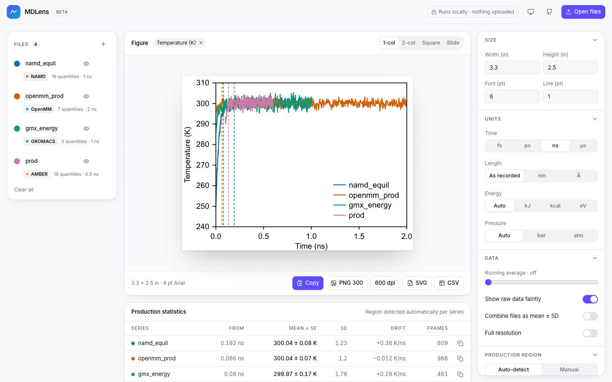

# MDLens

**Drop any MD log. Get equilibration-aware statistics and publication-ready figures, in your browser.**

MDLens reads output from GROMACS, NAMD, OpenMM, CHARMM, LAMMPS, AMBER and PLUMED, figures out which engine wrote it, finds where each run equilibrated, and exports figures sized for journals and slides. Nothing is installed and nothing is uploaded: files are parsed locally in the browser, so unpublished data stays on your machine.

**Live app:** https://strawberryhunter.github.io/mdlens/



## What it does

- **Any engine, one view.** The engine is detected from the file contents. Engine-specific names (`TEMP`, `Temp`, `TEMPerature`, `TEMP(K)`) map to one quantity, and units are converted (kcal ↔ kJ, atm ↔ bar, Å ↔ nm, fs/ps/ns/µs), so runs from different engines overlay directly.
- **Equilibration detection.** For every quantity, MDLens picks the start of the production region that maximises the number of uncorrelated samples ([Chodera, *J. Chem. Theory Comput.* 2016, 12, 1799](https://doi.org/10.1021/acs.jctc.5b00784)). The cut-off is marked on the figure.
- **Honest error bars.** Production averages come with a standard error corrected for autocorrelation (statistical inefficiency), not the naive SD/√N. Values are rounded the way papers report them and copy as `300.0 ± 0.4 K`.
- **Overview at a glance.** Every quantity gets a card with its production mean, a sparkline and an equilibration status ("Equilibrated at 0.192 ns", "Still relaxing at > 50% of run").
- **Figures for papers.** 1-column (3.3 in), 2-column (7 in), square and 16:9 presets; stacked panels with a, b, c labels; colour-blind-safe palette; legend placed where it hides the least data. Export SVG (physical size in inches), PNG at 300/600 dpi with DPI metadata (pastes into PowerPoint at the right size), clipboard, or CSV.
- **Replicas.** Overlay files, or combine them into a mean ± SD band.

## Supported formats

| Engine | Files | Notes |
|---|---|---|
| GROMACS | `.xvg` from `gmx energy`, `rms`, `rmsf`, `gyrate`, `sasa`, … | Grace escapes (`nm\S2\N`, `\xD\f{}G`) rendered as nm², ΔG; `xydy` error columns |
| NAMD | standard output (`ETITLE:` / `ENERGY:`) | time from `TIMESTEP` |
| OpenMM | `StateDataReporter` CSV or tab-separated logs | includes CHARMM-GUI `openmm_run.py` output |
| CHARMM | dynamics output (`DYNA>` lines) | fixed-width numbers that run together; restarted runs joined |
| LAMMPS | `log.lammps` thermo output (one/custom) | units from the `units` style; multiple runs merged |
| AMBER | `mdout` (sander / pmemd) | averages and fluctuations blocks skipped |
| PLUMED | `COLVAR`, `HILLS` | `#! FIELDS` header |
| Any | CSV, TSV or whitespace tables, cpptraj `.dat`, LAMMPS `fix ave/time` | names from the header or last comment line |

## Development

```bash
npm install
npm run dev        # http://localhost:5173
npm test           # unit tests (Vitest)
npm run build      # static site in dist/
```

Utilities:

```bash
npm run check-dir -- ~/simulations                 # parse every MD file under a folder and report problems
npm run render -- out.svg "Temperature" a.log b.csv # render a figure from the command line
npm run samples                                    # regenerate public/samples
```

The parsing, unit and statistics code in `src/lib` has no DOM dependency and is covered by tests; `src/components` is the React UI (Tailwind CSS). Figures are drawn with [Observable Plot](https://observablehq.com/plot/).

```
src/lib/formats/   engine parsers and detection
src/lib/units.ts   unit normalisation and conversion
src/lib/stats.ts   equilibration detection, statistical inefficiency, LTTB downsampling
src/lib/workspace.ts  quantities across files, figure panels
src/lib/figure.ts  SVG figure with stacked panels
src/lib/export.ts  SVG / PNG (with DPI) / CSV export
```

## Roadmap

Block-averaging error analysis, histograms and distributions, `.xpm` heat maps (free-energy landscapes, DSSP), GROMACS `.edr` reading, session save/restore.

## License

[MIT](LICENSE)
